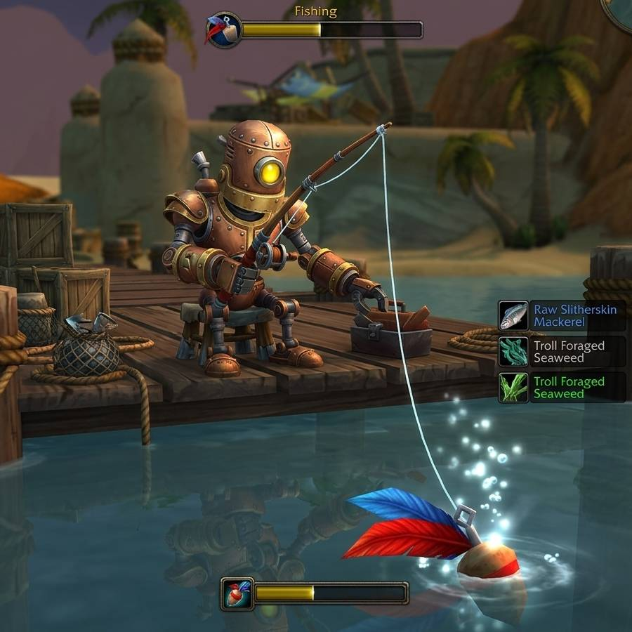

<h1>WoW Fishing Forever</h1>

<strong>A fishing bot for WoW</strong>

  
  

  <a href="#install"><b>Install</b></a>
  &nbsp;·&nbsp;
  <a href="#go-fish"><b>Go Fish</b></a>
  &nbsp;·&nbsp;
  <a href="#commands"><b>Commands</b></a>
  &nbsp;·&nbsp;
  <a href="#how-it-works"><b>How It Works</b></a>
  &nbsp;·&nbsp;
  <a href="#license"><b>License</b></a>

A fishing bot for **World of Warcraft: Forever**, so you can fish *forever*. It watches the
game window for the built-in interact icon over your bobber, listens to the game's own splash
sound for the bite, and presses your Interact key.

> [!NOTE]
> This project is meant to be accessible to anyone: a GUI and prebuilt executables are provided
> alongside the command line. Enjoy, but understand the risk you're taking.

## Install

### Download an executable (easy, but not recommended)

> [!CAUTION]
> Blizzard uses Warden, an anti-cheat program running alonside World of Warcraft. Warden is known
> to scan for open window titles or process names. They can discover this project and ban "AppleBinks*".
> Thus, it is recommended that you clone, rename the window title and process, and run the python, itself.

Grab the file for your OS from the
[latest release](https://github.com/DYDY2MONOI/wow-fish/releases/latest):

| OS | file |
|---|---|
| Windows 10/11 (x86_64) | `AppleBinks-<version>-windows-x86_64.exe` |
| macOS (Apple Silicon) | `AppleBinks-<version>-macos-arm64` |
| Linux (x86_64) | `AppleBinks-<version>-linux-x86_64` |

The executables are not code-signed, so the first launch needs one extra step:

- **Windows:** SmartScreen shows "Windows protected your PC". Click *More info*, then
  *Run anyway*.
- **macOS:** Gatekeeper blocks it. Run `xattr -d com.apple.quarantine AppleBinks-*` in Terminal
  once, and `chmod +x AppleBinks-*` if needed. Intel Macs: use the developer install below.
- **Linux:** `chmod +x AppleBinks-*`.

Verify downloads against `SHA256SUMS.txt` from the same release.

### Run from source

Clone and run in place:

    git clone https://github.com/DYDY2MONOI/wow-fish AppleBinks
    cd AppleBinks
    uv sync --group dev
    uv run AppleBinks doctor

### Additional step for Mac users

Mac users need to install a virtual loopback device such as [BlackHole](https://existential.audio/blackhole/), route the game's audio through it, and pick it on the Setup tab (this sets `audio.capture = "device"`).

## Go Fish

> [!CAUTION]
> **Use at your own risk.** Automating gameplay violates Blizzard's terms of service and can
> get your account banned. This project exists for educational purposes only.

In the game:

1. *Options > Gameplay > Controls*: enable **Auto Loot**.
2. *Options > Keybindings > Targeting*: bind **Interact With Target**. AppleBinks assumes `f`.
3. Put **Fishing** on an action bar key. AppleBinks assumes `1`.
4. Type `/console SoftTargetIconGameObject 1` once. This shows the gold gear icon over your
   bobber whenever it is close enough to interact with.
5. *Options > Sound*: set **Ambience** and **Music** to 0 and keep **Sound Effects** up.

**Note to Linux users**: On GNOME, the first synthetic key press opens a "Remote Desktop" dialog. Switch on *Allow Remote Interaction* and click *Share*. Until you do, key presses are silently dropped.

**Note to Wayland users**: A game running as a native Wayland client (e.g. Proton with `PROTON_ENABLE_WAYLAND=1`) is supported on Hyprland: install [`grim`](https://gitlab.freedesktop.org/emersion/grim) for screen capture; keys go through the compositor's virtual keyboard. The game must be on screen while fishing. On other compositors, run the game under Xwayland (`PROTON_ENABLE_WAYLAND=0`).

**Note to Windows users**: You may need to run the program in admin mode.

Stand at the water and run the GUI:

    AppleBinks gui          # or double-click AppleBinks-gui

Or run it from terminal:

    AppleBinks doctor                      # checks the compatibility with this machine
    AppleBinks config                      # creates the config file; edit cast_key / interact_key
    AppleBinks run                         # measures the icon on its first cast; Ctrl-C stops

While the bot is running, keep the water in view and the game client in focus.

## Commands

| command | what it does |
|---|---|
| `AppleBinks gui` | The setup and fishing window |
| `AppleBinks run [--minutes N] [--record-audio WAV]` | Fish from the terminal until Ctrl-C or the session limit; optionally save everything heard |
| `AppleBinks doctor` | Check OS, display, OpenCV, audio devices, game window, input, calibration, config |
| `AppleBinks calibrate SHOT.png [--save]` | Measure the interact icon's on-screen size from a screenshot |
| `AppleBinks watch --live` | Show what the matcher sees: phase, score, position, milliseconds per frame |
| `AppleBinks watch --from DIR` | Same, over saved frames; `--save-frames` writes annotated thumbnails |
| `AppleBinks listen [--list] [--device D] [--record WAV]` | Meter the game's audio (or loopback device D), print bites as they are heard |
| `AppleBinks verify-bite WAV [--save]` | Score a recording against every splash clip and pick the bite |
| `AppleBinks config` | Create the config file if needed and print the resolved settings |
| `AppleBinks config --path` | Print only the config file location |
| `AppleBinks --version` | Print the version |

Add `--verbose` before any command for debug logging. `doctor` prints the log file path.

## How It Works

This bot looks at pixels and listens to sound, and it presses the keys to cast and loot. It does not read memory, inject code, inject network traffic, or rely on an addon.

1. **Cast**: It casts using your specified cast key. Each key press is simulated with a `key_hold_ms` timer.
2. **Detect bobber**: WoW draws a gold gear sprite over the bobber when it is in interact
range. If you do not see the gold gear sprite above the bobber, that means the bobber is out of range for the interact key to work, so the bot will recast. The bot will scan for the sprite using template matching from OpenCV, and it matches it against the game window with a masked, mean-subtracted template match. If it doesn't find it, it will recast until it does. 
3. **Detect bite**: WoW plays one of its splash clips when a fish bites. The bot fingerprints the first 0.8 seconds of each as a log-mel spectrogram with the gain removed. If there's a match, the bot will simulate the interact key, and auto-loot should pick up your fish. After all that, the bot recasts.

## License

MIT. See [LICENSE](LICENSE).
